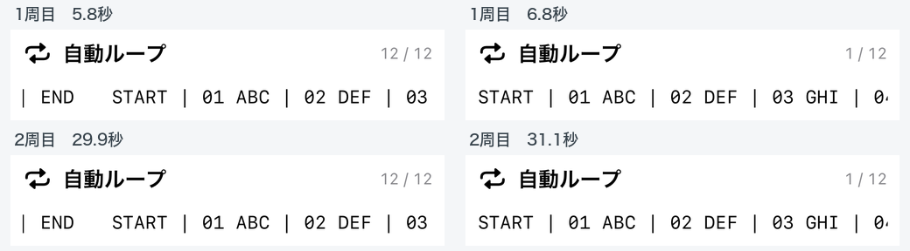

# WidgetMarquee

iPhoneのホーム画面Widgetで、1行に収まらない文字列を自動で左に送り、末尾から先頭に戻って繰り返すSwift Packageです。ホーム画面にWidgetを追加するだけで動きます。SwiftUIとWidgetKitの公開APIを使用します。対応はiOS 17以降、Swift tools 5.9以降です。



## インストール

Xcodeの **File → Add Package Dependencies…** で `https://github.com/TentoSwift/WidgetMarquee.git` を指定し、バージョン `1.0.1` 以降の製品 `WidgetMarquee` をWidget Extensionターゲットに追加します。

`Package.swift` から追加する場合は、`dependencies` に次の行を指定します。

```swift
.package(url: "https://github.com/TentoSwift/WidgetMarquee.git", from: "1.0.1")
```

## 好きな文章を表示する

1. [HeadlineWidget.swift](Examples/HeadlineWidget.swift) をWidget Extensionターゲットに追加し、テンプレートの `@main` をこのサンプルに置き換えます。
2. アプリを実行し、iPhoneのホーム画面に中サイズの「Headline」を追加します。
3. Widgetを長押しして「ウィジェットを編集」を開き、「テキスト」に好きな文章を入力します。編集を閉じると、その文章で表示が始まります。

文章はWidgetごとに設定できます。空欄や空白だけの入力には見本の文章を表示します。1行に収まる短い文章は静止し、長い文章は自動で横に流れます。

## 自分のWidgetに組み込む

表示したい `String` とエントリの日時を `WidgetMarquee` に渡します。次の例はWidgetの編集画面で設定した文章を `AppIntentTimelineProvider` からビューへ渡します。`schedule(for:)` は文章の長さに合わせて一周の段階数を増やします。プロバイダとビューで同じ設定を使ってください。[設定とプロバイダの全コード](Examples/HeadlineWidget.swift)

```swift
// HeadlineProvider 内
func timeline(for configuration: HeadlineConfiguration, in context: Context) async -> Timeline<HeadlineEntry> {
    let headline = configuration.headline
    return schedule(for: headline).timeline(from: .now) { date in
        HeadlineEntry(date: date, headline: headline)
    }
}
```

Widgetのビューはエントリの日時からその時点の表示位置を決めます。「視差効果を減らす」が有効な場合や画面の輝度が下がった場合は先頭を静止表示します。VoiceOverは文章全体を1回で読み上げます。

```swift
WidgetMarquee(entry.headline, date: entry.date, schedule: schedule(for: entry.headline))
    .containerBackground(.background, for: .widget)
```

## 周期と更新

既定では2秒ごとに12の表示位置を順に使い、約24秒で一周します。`stepsPerPass` には2〜3,600を指定できます。たとえば `WidgetMarqueeSchedule(stepsPerPass: 30)` にすると、一周は約60秒です。長い文字列では、1回の移動距離が表示幅を超えないように段階数を増やすと、途中の文字も読めます。`schedule.phase(at: entry.date)` は現在位置を0始まりで返します。

スケジュールは5分ぶんの151エントリをまとめて返し、4分後の再読み込みをWidgetKitに依頼します。各位置は絶対時刻に対応するため、次のタイムラインでも続きから表示できます。iOS 27.2のiPhone 17 Proシミュレータでは、操作せずに複数回折り返し、最初の5分を超えても次のタイムラインで更新が続くことを確認しました。

**2秒間隔は実験用の設定です。** Appleの推奨するエントリ間隔の目安は約5分以上です。OSは更新をまとめたり遅らせたりするため、コマ送りになることがあり、予定を使い切ると次の読み込みまで最後の位置で待ちます。上の画像と検証記録の対象はホーム画面Widgetです。実機での電力消費や長時間の更新間隔は未計測です。[WidgetKitの更新仕様](https://developer.apple.com/documentation/widgetkit/keeping-a-widget-up-to-date/)

## ライセンス

[MIT License](LICENSE)
