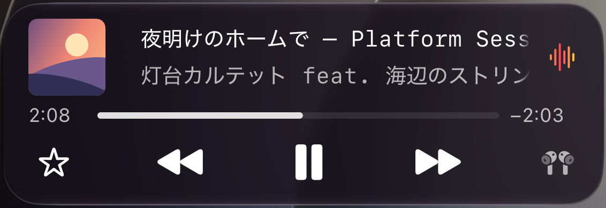

# MarqueeKit

MarqueeKitはSwiftUIアプリ、ホーム画面Widget、Live Activityで文字列を自動スクロールするSwift Packageです。横送りでは1行を左に、縦送りでは文字を縦1列に並べて上に送ります。表示領域に収まる文章は静止し、長い文章は末尾から先頭に戻って繰り返します。対応環境はiOS 17以降、Swift tools 5.9以降です。



## インストール

Xcodeの **File → Add Package Dependencies…** で `https://github.com/TentoSwift/MarqueeKit.git` を指定し、バージョン `1.6.0` 以降を選びます。マーキーを表示するアプリやWidget Extensionのターゲットに製品 `MarqueeKit` を追加します。

Swift Packageから利用する場合は、`Package.swift` の `dependencies` にリポジトリを追加します。

```swift
.package(url: "https://github.com/TentoSwift/MarqueeKit.git", from: "1.6.0")
```

利用するターゲットの `dependencies` には製品を指定します。

```swift
.product(name: "MarqueeKit", package: "MarqueeKit")
```

1.5.0でパッケージ名とリポジトリ名を `WidgetMarquee` から `MarqueeKit` に変更しました。既存プロジェクトではURLと製品の指定を上記に合わせ、インポートを `import MarqueeKit` に変更します。ビューの名前は引き続き `WidgetMarquee` と `LiveActivityMarquee` です。`import WidgetMarquee` を使うターゲットでは互換用の製品 `WidgetMarquee` を選べます。

## Live Activityで再生カードを作る

冒頭の画像は同梱のサンプルをiPhoneシミュレータのロック画面で表示したものです。ロック画面と展開したDynamic Islandには、ジャケット、曲名、アーティスト名、経過時間と残り時間、再生ボタンが並びます。コンパクト表示ではジャケットと再生状態が見えます。[展開したDynamic Islandの表示](Documentation/now-playing-island.png)

曲名とアーティスト名をそれぞれ `LiveActivityMarquee` に渡します。下の例ではジャケットや右のアイコンを除いた幅を `GeometryReader` で測り、収まる行は静止させます。長い行は平均32 pt/秒で流れ、次の周回が始まるのは両方が先頭に戻ってから2秒後です。[曲名とアーティスト名が流れる録画（MP4）](https://github.com/TentoSwift/MarqueeKit/releases/download/1.6.0/now-playing.mp4)

```swift
import MarqueeKit
import SwiftUI

// NowPlayingCard のジャケットと再生状態のアイコンの間に置く
GeometryReader { area in
    let group = WidgetMarqueeGroup(
        [state.track.title, state.track.artist], startedAt: state.titleStartedAt,
        pointsPerSecond: 32, timing: .easeInOut, pauseBetweenLoops: 2,
        viewportWidth: area.size.width
    )
    VStack(alignment: .leading, spacing: 0) {
        ForEach(group.rows) { row in
            LiveActivityMarquee(row)
                .foregroundStyle(row.id == 0 ? Color.white : Color.white.opacity(0.68))
        }
    }
    .marqueeEdgeFade(length: 8, clearance: 4)
}
.frame(height: 46)
```

### 再生カードを試す

1. アプリのInfo.plistで `NSSupportsLiveActivities` を有効にします。
2. 曲とボタンの処理を定義する [NowPlayingAttributes.swift](Examples/NowPlayingLiveActivity/NowPlayingAttributes.swift) をアプリとWidget Extensionの両方に追加します。
3. カードのレイアウトを定義する [NowPlayingLiveActivity.swift](Examples/NowPlayingLiveActivity/NowPlayingLiveActivity.swift) を拡張に追加し、拡張の `@main WidgetBundle` の `body` に `NowPlayingLiveActivity()` を登録します。
4. アプリをフォアグラウンドで開き、ボタンなどから `try NowPlayingAttributes.start()` を呼びます。

カードのボタンでお気に入り、前の曲、再生・一時停止、次の曲を操作できます。サンプルは架空の3曲を切り替えます。再生時間とボタンはカード内の状態に連動し、音声再生は含みません。右端のイヤフォンは出力先の表示例です。

### 文章を1行だけ表示する

ロック画面のカードや展開したDynamic Islandで、`LiveActivityMarquee` に文章と開始日時を渡します。

```swift
import MarqueeKit

// ActivityConfiguration の Lock Screen ビューまたは DynamicIslandExpandedRegion 内
LiveActivityMarquee(context.state.text, startedAt: context.attributes.startedAt)
```

iOS 18以降では、アプリがバックグラウンドにあっても長い文章が自動で流れます。速度指定を省略した場合は約10秒で一周します。OSが描画するストップウォッチと本文を1行に並べ、文字送り用フォントが経過時間に応じて透明な文字の幅を縮めます。フォントはパッケージに同梱しており、アプリから文字送りを駆動するタイマーやプッシュ通知、`Activity.update` は不要です。[SwiftUIのストップウォッチ](https://developer.apple.com/documentation/swiftui/systemformatstyle/stopwatch)

iOS 17で実行するかiOS 17 SDKでビルドした場合は、約1秒ごとに位置を更新します。どちらの方式でも表示領域に収まる文章は静止し、「視差効果を減らす」が有効なときや常時表示で輝度が下がったときも先頭を表示します。VoiceOverは元の文章を1回で読み上げます。

iPhone 17 Proシミュレータ（iOS 27.2）で日本語の文章を横に送ったとき、文字の位置が変わった回数は点灯中のロック画面で毎秒約51回、展開中のDynamic Islandで毎秒約50回でした。下の録画は等速の行を切り出したものです。1.3.0では時計の分が変わる瞬間に文字が逆向きに動く問題を、1.4.3では同期した2行の描画データがサイズ上限を超え、Live Activityが開始直後に終了することがあった問題を修正しました。1.4.3では文字送り用のフォントを小さくし、同じAPIで使えるようにしています。


AppleのFrameworks Engineerはタイマーとカスタムフォントを使うアニメーションをサポート対象外としており、電池や性能への影響を指摘しています。更新頻度はOSと表示状態に左右されます。加減速、待機、複数行の同期を指定したLive Activityでは、一周を4,096段階で表します。文章や待ち時間が非常に長いと、文字送りの刻みが目立つことがあります。同期した行の加減速は共通の時刻で移動距離を補間するため、画面上で各行が止まる時刻には丸めが入ります。[Appleの技術者による説明](https://developer.apple.com/forums/thread/757696)

### 1行表示のサンプルを実行する

1. アプリのInfo.plistで `NSSupportsLiveActivities` を有効にします。
2. [MarqueeActivityAttributes.swift](Examples/MarqueeLiveActivity/MarqueeActivityAttributes.swift) はアプリとWidget Extensionの両ターゲットに、[MarqueeLiveActivity.swift](Examples/MarqueeLiveActivity/MarqueeLiveActivity.swift) は拡張に追加します。
3. 拡張の `@main WidgetBundle` の `body` に `MarqueeLiveActivity()` を追加します。

アプリがフォアグラウンドにあるときに開始します。次の関数に、表示したい文章を渡します。

```swift
import ActivityKit
import Foundation

func startMarquee(_ message: String) throws -> Activity<MarqueeActivityAttributes> {
    let attributes = MarqueeActivityAttributes(startedAt: .now)
    return try Activity.request(
        attributes: attributes,
        content: try attributes.content(for: message, pointsPerSecond: 40),
        pushType: nil
    )
}
```

文章や速度を変えるときは `await activity.update(try activity.attributes.content(for: newText, pointsPerSecond: 60))` を呼びます。終了には `await activity.end(nil, dismissalPolicy: .immediate)` を使います。サンプルは送信前に、属性と状態の合計がActivityKitの4 KB制限に収まるかを確認します。自動ループはLive Activityが動作している間続きます。1回のActivityの上限は8時間です。[AppleのLive Activity仕様](https://developer.apple.com/documentation/activitykit/displaying-live-data-with-live-activities)

ActivityKitの状態を更新したときに1段だけ送るには、状態に表示位置を示す日時を持たせ、`WidgetMarquee(text, date: positionDate)` に渡します。iPhone Duo（iOS 27.3）で確かめた際は、経過タイマーが8秒進む間も文字位置は同じで、更新を1件送ると位置が変わりました。[シミュレータでの比較画像](Documentation/live-activity.png)

## SwiftUIアプリで使う

`WidgetMarquee` に任意の `String` を渡します。画面で入力した文字列やモデルから取得した値も使えます。

```swift
import SwiftUI
import MarqueeKit

struct MessageView: View {
    let text: String

    var body: some View {
        WidgetMarquee(text)
    }
}
```

### 縦送りと端のフェード

縦送りには `axis: .vertical` と表示する高さを指定します。漢字、英数字、絵文字を正立させたまま1文字ずつ縦に並べます。結合文字や複数の文字コードで表す絵文字も、Swiftの `Character` ごとに1段に収めます。既定の向きは `.horizontal` です。

```swift
WidgetMarquee("京都から東京へ向かう新幹線", pointsPerSecond: 30, axis: .vertical)
    .marqueeEdgeFade(length: 10, clearance: 6)
    .frame(height: 84)
```

`marqueeEdgeFade(length:clearance:)` は、横送りなら左右、縦送りなら上下に適用します。`length` は端で文字が透明になってから完全に見えるまでの幅、`clearance` はその内側から周回の先頭文字までの余白です。どちらも単位はptです。上の例では各端の10 ptで文字が薄くなり、周回の開始時や待機中は先頭文字の枠が上端から16 ptの位置に来ます。横送りでも同じ指定で左端からの距離を調整できます。

既定はフェードなし、`clearance` は0です。短い文章にはフェードをかけません。`length` が0以下または非有限の場合はフェードと余白が無効になり、負または非有限の `clearance` は0として扱います。表示領域が小さい場合は中央に20 ptを確保できる範囲に両端の幅を抑え、フェードを優先して余白を縮めます。

ホーム画面Widgetではプロバイダのタイムラインに、Live Activityではビューに `axis: .vertical` を指定してください。いずれも高さを指定し、フェードは表示側で設定します。

```swift
// ホーム画面Widgetのプロバイダ
WidgetMarquee.timeline(for: text, pointsPerSecond: 30, axis: .vertical)

// ホーム画面Widgetのビュー
WidgetMarquee(entry)
    .marqueeEdgeFade(length: 10, clearance: 6)
    .frame(height: 84)

// Live Activityのビュー
LiveActivityMarquee(text, startedAt: startedAt, pointsPerSecond: 30, axis: .vertical)
    .marqueeEdgeFade(length: 10, clearance: 6)
    .frame(height: 84)
```

Live Activityは描画データの大きさを抑えるため、縦1列を複数の画像に分けます。本文とカラー絵文字の切り替わりで区切り、同じ種類が続くときは64文字ごとに区切ります。1列あたりの上限は96文字、画像24枚です。どちらかを超えると先頭部分を静止表示し、同期するほかの列の周回時間には含めません。Live Activityには、向きにかかわらずUTF-8で4,096バイトを超える文章を静止させる制限もあります。VoiceOverはどちらの場合も元の文章全体を読み上げます。アプリとホーム画面Widgetでは画像分割による制限はありません。

## スクロールの速度、加減速、周回の待ち時間

`pointsPerSecond` は移動中の平均速度をpt/秒で指定します。既定の `timing` は等速の `.linear` です。単独の行に `.easeInOut` を指定すると、周回の始めと終わりはゆっくり動き、中央で最も速くなります。`pauseBetweenLoops` は先頭に戻ってから次の周回までの待ち時間で、既定は0秒です。

```swift
// SwiftUIアプリ
WidgetMarquee(text, pointsPerSecond: 40, timing: .easeInOut, pauseBetweenLoops: 2)

// ホーム画面Widgetのプロバイダ
WidgetMarquee.timeline(for: text, pointsPerSecond: 40, timing: .easeInOut, pauseBetweenLoops: 2)

// Live Activity
LiveActivityMarquee(text, startedAt: startedAt, pointsPerSecond: 40,
                    timing: .easeInOut, pauseBetweenLoops: 2)
```

速度、加減速、待ち時間は個別に省略できます。速度を省略した場合、Live Activityは10秒で一周します。SwiftUIアプリとホーム画面Widgetの周期は文章の長さで決まります。たとえばLive Activityに `pauseBetweenLoops: 2` だけを指定すると、10秒かけて移動して2秒待ちます。速度が0以下または非有限の場合は静止し、負または非有限の待ち時間は0秒として扱います。

iOS 27.2シミュレータのLive Activityでは、同じ文章に30、60 pt/秒を指定して、それぞれ約30、60 pt/秒で移動することを確認しました。90 pt/秒・待機2秒では、等速の行は約5.7秒で一周して約2秒静止しました。加減速のある行は同じ周期で、中央の速度は約135 pt/秒でした。[加減速と2秒待機の録画（MP4）](https://github.com/TentoSwift/MarqueeKit/releases/download/1.3.0/live-activity-ease-and-pause.mp4)

## 複数の行を一緒に再開する

`WidgetMarqueeGroup` にまとめた行はそれぞれの速度で一周します。先に一周した行は先頭で待ち、最後の行が戻ってから `pauseBetweenLoops` 秒後に全行が再開します。待ち時間が0なら、最後の行が戻ると同時に再開します。[長さの異なる2行が一緒に再開する録画（MP4）](https://github.com/TentoSwift/MarqueeKit/releases/download/1.4.0/synchronized-marquees.mp4)

```swift
let group = WidgetMarqueeGroup(
    [title, subtitle], startedAt: context.attributes.startedAt,
    pointsPerSecond: 40, timing: .easeInOut, pauseBetweenLoops: 2
)

VStack(alignment: .leading, spacing: 4) {
    ForEach(group.rows) { row in LiveActivityMarquee(row) }
}
```

SwiftUIアプリでは `group.rows` の各要素を `WidgetMarquee(row)` に渡します。`startedAt` はアプリの状態かLive Activityの属性に保存し、ビューを描き直すときも同じ値を使ってください。各行を独立して周回させる場合は、文章をビューに直接渡します。

長さの異なる行に同じ `pointsPerSecond` と `.easeInOut` を指定すると、一緒に加速して同じ巡航速度に達します。減速するのは各行が自分の終点に近づいたときです。短い行が先頭で待っている間も、長い行はそのまま進みます。`pointsPerSecond` は移動中の平均速度なので、加減速のある行では巡航速度が指定値を少し上回ります。`.linear` の行は一周を通して指定した速度で動きます。[短い行が止まる前後の録画（MP4）](https://github.com/TentoSwift/MarqueeKit/releases/download/1.4.2/independent-marquee-stops.mp4)

横送りでは `viewportWidth` にラベルと余白を除いた本文の幅を渡してください。グループはその幅に収まる行を加減速と待ち時間の計算から除外します。縦送りでは `axis: .vertical` と `viewportLength` に本文の表示方向と高さを指定します。速度0の行もほかの行を待たせません。行によって速度や表示幅が異なる場合は `items:` を指定します。

```swift
let group = WidgetMarqueeGroup(items: [
    .init(title, pointsPerSecond: 30, viewportWidth: titleWidth),
    .init(subtitle, viewportWidth: subtitleWidth)
], startedAt: startedAt, pointsPerSecond: 50, pauseBetweenLoops: 2)
```

ホーム画面Widgetで同期する場合は、プロバイダのエントリ型を `WidgetMarqueeGroupEntry` にし、`timeline` から `group.timeline()` を返します。`placeholder` と `snapshot` には `WidgetMarqueeGroupEntry(group)` を使います。1つのエントリに全行の位置が入るため、Widgetのビューでは行を順に並べます。再読み込み時にも同じ開始日時を使います。

```swift
VStack(alignment: .leading) {
    ForEach(entry.rows.indices, id: \.self) { index in
        WidgetMarquee(entry.rows[index])
    }
}
```

## ホーム画面Widgetで使う

プロバイダから `WidgetMarquee.timeline(for:)` を返します。各エントリには文章、表示日時、スクロール設定が入ります。`placeholder` と `snapshot` では `WidgetMarqueeEntry("見本の文章")` を返せます。

```swift
// AppIntentTimelineProvider のメソッド
func timeline(for configuration: HeadlineConfiguration, in context: Context) async -> Timeline<WidgetMarqueeEntry> {
    WidgetMarquee.timeline(for: configuration.headline)
}
```

Widgetのビューにはそのエントリを渡します。

```swift
WidgetMarquee(entry)
    .containerBackground(.background, for: .widget)
```

独自の `TimelineEntry` を使う場合は `WidgetMarquee(entry.headline, date: entry.date, schedule: schedule)` と `schedule.timeline(from:entry:)` を組み合わせられます。

### ホーム画面で文章を編集するサンプル

1. [HeadlineWidget.swift](Examples/HeadlineWidget.swift) をWidget Extensionターゲットに追加し、テンプレートの `@main` をサンプルの `@main` に置き換えます。
2. アプリを実行し、iPhoneのホーム画面に中サイズの「Headline」を追加します。
3. Widgetを長押しして「ウィジェットを編集」を開き、「テキスト」に好きな文章を入力します。編集画面を閉じると反映されます。

文章はWidgetごとに設定できます。空欄や空白だけの場合は見本の文章を表示します。短い文章は静止し、長い文章は自動でスクロールします。「視差効果を減らす」が有効な場合や画面の輝度が下がった場合は、先頭を静止表示します。VoiceOverは文章全体を1回で読み上げます。

## ホーム画面Widgetの周期と更新


既定の更新間隔は2秒です。自動設定では最低12段階で一周し、長い文章では段階数が増えます。周期を調整するには `let pace = WidgetMarqueeSchedule(stepsPerPass: 30)` のように設定を作り、アプリでは `WidgetMarquee(text, schedule: pace)` に、Widgetでは `WidgetMarquee.timeline(for: text, schedule: pace)` に渡します。30段階なら一周は約60秒です。2〜3,600段階の範囲で設定できます。

既定のスケジュールは5分ぶんの151エントリをまとめて返し、4分後の再読み込みをWidgetKitに依頼します。各位置は絶対時刻から決まるため、次のタイムラインも続きの位置を表示できます。iOS 27.2のiPhone 17 Proシミュレータでは、5分を超えてタイムラインが更新された後も、操作せずに複数回折り返すことを確認しました。

2秒間隔は実験用の設定です。Appleが推奨するエントリ間隔の目安は約5分以上です。OSは更新をまとめたり遅らせたりするため、文字がコマ送りになる場合があります。予定したエントリを使い切ると、次の読み込みまで最後の位置で待ちます。この節の画像と検証記録の対象はホーム画面Widgetです。実機での消費電力や長時間の更新間隔は未計測です。[WidgetKitの更新仕様](https://developer.apple.com/documentation/widgetkit/keeping-a-widget-up-to-date/)

## ライセンス

[MIT License](LICENSE)
